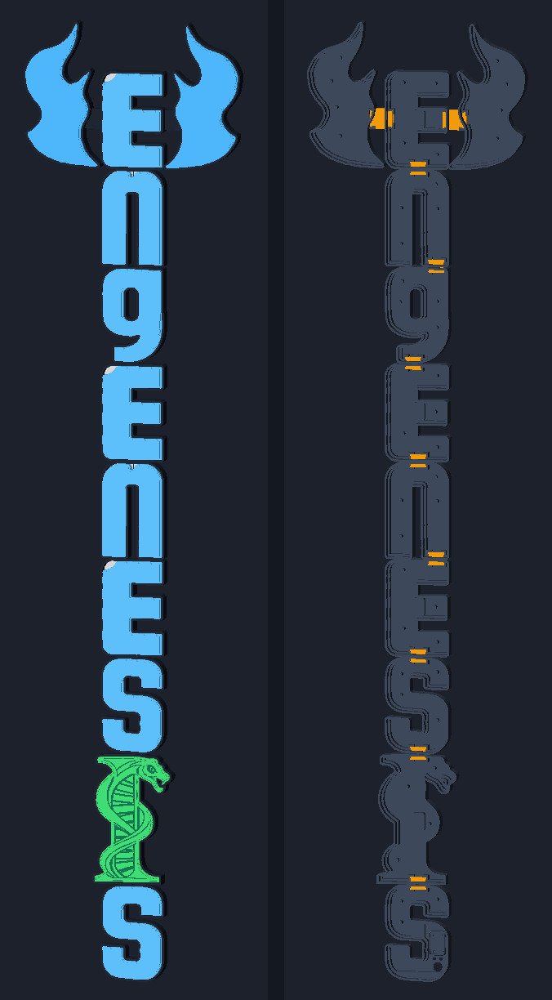
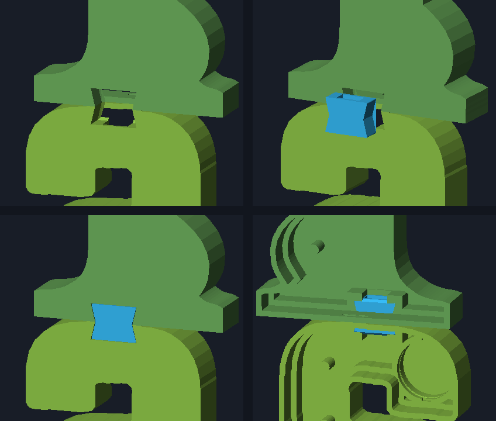
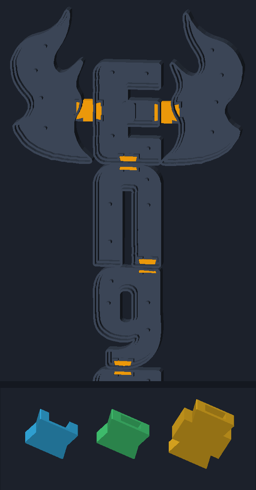

# Engenesis Vertical-Display Modular Sign (`engenesis-lamp-vertical`)

A vertical column / wall-display edition of the illuminated **ENGENESIS** light-box sign (`1,475.6 mm` / `58.1 in` / `4.84 ft` tall × `339.3 mm` wide across the top flames × `29.0 mm` total depth), duplicated and re-engineered from [`../engenesis-lamp/`](../engenesis-lamp/) to match [`images/vertical-concept.png`](./images/vertical-concept.png).

---

## Key Vertical-Display Engineering Changes

1. **Bottom cubicle divider clips & horizontal desk grooves removed:** Every base now has an exact `0.00 mm` bottom plane and a **100% flush rear wall (`Y = +12.50 mm`)** so the entire vertical column sits flat against a post, pillar, or wall.
2. **Rear-Entry Interlocking Hollow Double-Dovetail ("Bowtie") Conduit System:** Replaces external clips with rear-open female `14°` dovetail mortises + a **`14.0 mm` wide internal LED-strip channel** (`Y = +0.45 .. +12.50 mm`).
   - **Unobstructed rear insertion (`+Y → -Y`):** Because the `3.0 mm` front bezel overhangs the seam on the front side (`-Y`), the bowtie mortise opens out the **flat rear face (`Y = +12.50 mm`)** with a print-in-place `45°` internal depth-stop seat at `Y = +0.45 .. +2.00 mm`. Lay two letters face-down, push the Bowtie Key straight into the back until its solid `2.0 mm` rear cap sits dead-flush (`Y = +12.40 mm`), and once magnetically mounted, the wall/column traps every key permanently.
   - **Front bezel stays 100% unbroken & light-tight:** The front `13.0 mm` outer bezel (`Y = -12.50 .. +0.50 mm`), internal diffuser snap V-grooves, and `15.0 mm` hollow `45°`-beveled diffusers have **zero cutouts**, eliminating light leaks at every seam.

3. **Upgraded `1:1` `200 mm` Snake `I`:** Scaled to its full `200.0 × 124.2 mm` blueprint height (taller than the `150.0 mm` letters, matching the concept art) with `0.45 mm` engraved snake-coil and DNA-helix front-face relief grooves.
4. **Print-in-place blind rear screw keyholes (`X = 0.00 mm` plumb line):** Built into `E_top`, `E_mid`, `E_low`, `I`, and `S_bottom` with a `45°` self-supporting internal roof and a `2.30 mm` solid inner light cap (fits `#6` / `#8` / `M4` pan-head screws with zero supports and zero light leaks).

---

## Why a Captive Hollow Bowtie Key Works Best for 3D-Printed LED Signs

| Connector Candidate | Printability (Base Flat on Back) | Gravity / Tensile Strength | Fits `10–12 mm` LED Strip Inside? | Verdict |
|---|---|---|---|---|
| **Captive Hollow Double-Dovetail ("Bowtie" Spline)** *(Used)* | **Zero supports** — `14°` undercut lies in the crisp `XY` build plane | **Highest (`>25 kg`)** — continuous axial perimeter loops carry tension perpendicular to layer lines | **Yes (`13.6 × 8.0 mm` clear bore)** — open U-straddle key drops right over an uncut strip | **Winner** |
| Integral Vertical Male Tenon + Female Mortise | Requires bridging/supports or sticks out past `250 mm` print beds | Good, but sliding letters together along `Z` buckles/pinches the LED strip inside blind pockets | Blind assembly crushes strip | Avoid |
| Integral Cantilever Snap Clips | Layer lines run across clip root — snaps off brittlely under `~1.2 kg` sign weight | Weak in `Z` tension | Narrow throat pinches `10 mm` strip | Avoid |
| Twist-Lock Bayonet Boss | Cannot twist letters `45°` once adjacent letters or wires are attached | Good | Twists & shears LED strip | Avoid |

---

## Passing the LED Strip Between Letters (Two Supported Wiring Methods)

Every white reflector (`*_reflector.stl`) has an aligned **`15.0 × 7.0 mm` (`R = 2.0 mm`) pass-through pocket** centered `15.5 mm` inward from each active joint, plus a **`1.50 mm` edge entry slit** so pre-wired strips or 3-wire jumpers slip sideways into the reflector without desoldering.

### Method A — Continuous Uncut `10 mm` / `12 mm` WS2812B Strip *(Use `connector_key_vertical.stl`)*
1. Lay the printed letter bases face-up on a workbench in stack order (`E_top` down to `S_bottom`, plus `FL` and `FR` flanking `E_top`).
2. Adhere the LED strip around each letter's `13.0 mm` front inner perimeter wall (`Y = -12.0 .. -2.0 mm`). At each joint, fold the strip gently (`R ≥ 6 mm` along its flat face — never bend edgewise) back into the open `14.0 mm` rear trough (`Y = +2.8 .. +11.0 mm`) into the next letter.
3. Press the **U-Channel Straddle Keys** ([`connector_key_vertical.stl`](./connectors/connector_key_vertical.stl), blue key above) straight down (`-Y → +Y`) **over the strip** into the mating dovetail mortises. The `2.20 mm` front web locks both letters together while the `13.6 × 8.0 mm` U-channel straddles the strip without pinching it.
4. Slip each `2.0 mm` white reflector over the strip via its `1.50 mm` slit (trapping the Bowtie Keys), then click the hollow diffusers into the snap grooves.

### Method B — Modular Plug-Together Letters with 3-Pin `JST-SM` Pigtails *(Use `connector_key_vertical_closed.stl`)*
1. Pre-install each letter's LED strip on the bench with short 3-wire silicone leads (`22–26 AWG`) or `JST-SM` 3-pin plugs (`13.2 × 6.2 mm` housing passes straight through the `13.6 × 6.4 mm` closed tunnel).
2. Lock adjacent bases together with [`connector_key_vertical_closed.stl`](./connectors/connector_key_vertical_closed.stl) (green key above) and [`connector_key_flame.stl`](./connectors/connector_key_flame.stl) (gold bridge key above), click the `JST-SM` plugs together inside the rear chamber, seat the reflectors, and snap on the diffusers.
3. **Power injection tip (`~11` modules / `~420` LEDs at `60 LEDs/m`):** Run a parallel `20 AWG` `5V + GND` pair down the same `13.6 mm` hollow channel from `S_bottom` to `E_mid` and `E_top` so brightness stays uniform from bottom to top.

---

## Letter Spacing (12.70 mm Seam)

Letters stand **12.70 mm (0.5 in)** apart edge-to-edge (`joint_gap` in [engenesis_vertical_assembly.scad](./engenesis_vertical_assembly.scad)). Each vertical key bridges the seam:

- Key length along the seam = gap + 19.5 mm = **32.2 mm** (9.75 mm of dovetail goes into each letter's rear mortise).
- LED channel length = the full key length, so the strip runs across the gap and into both letters' rear troughs.
- Total tower height with 8 seams: 1,475.6 mm + 8 × 12.70 mm = **1,577.2 mm** (about 5.2 ft).

To change the spacing, edit `joint_gap` in the assembly and `bridge_gap` in [connectors/connector_key_vertical.scad](./connectors/connector_key_vertical.scad) (keep them equal), then re-export the keys. The 15.70 mm flame bridges are separate and are unaffected.

## Bill of Printed Parts & Socket Map (Top to Bottom)

| Stack Order | Folder | Base / Reflector / Diffuser | Qty | Exterior `W × H × D` | Active Interlocking Sockets |
|---:|---|---|---:|---|---|
| Top-Left | [`letters/FL/`](./letters/FL/) | `fl_base`, `fl_reflector`, `fl_diffuser` | `1` | `120.3 × 225.6 × 25.0 mm` | Right (`+X`) @ `Z_int = 72.3 mm` |
| **1 (Top)** | [`letters/E_top/`](./letters/E_top/) | `e_top_base`, `e_top_reflector`, `e_top_diffuser` | `1` | `100.0 × 150.0 × 25.0 mm` | Left (`-50`), Right (`+48.26`), Bottom (`X = 0`) + Wall Keyhole |
| Top-Right | [`letters/FR/`](./letters/FR/) | `fr_base`, `fr_reflector`, `fr_diffuser` | `1` | `120.3 × 225.6 × 25.0 mm` | Left (`-X`) @ `Z_int = 72.3 mm` |
| **2 & 5** | [`letters/n/`](./letters/n/) | `n_base`, `n_reflector`, `n_diffuser` | **`2`** | `100.0 × 150.0 × 25.0 mm` | Top (`X = 0`), Bottom (`X = +28` under right leg) |
| **3** | [`letters/g/`](./letters/g/) | `g_base`, `g_reflector`, `g_diffuser` | `1` | `100.0 × 150.0 × 25.0 mm` | Top (`X = +28`), Bottom (`X = -8` under tail) |
| **4** | [`letters/E_mid/`](./letters/E_mid/) | `e_mid_base`, `e_mid_reflector`, `e_mid_diffuser` | `1` | `100.0 × 150.0 × 25.0 mm` | Top (`X = -8`), Bottom (`X = 0`) + Wall Keyhole |
| **6** | [`letters/E_low/`](./letters/E_low/) | `e_low_base`, `e_low_reflector`, `e_low_diffuser` | `1` | `100.0 × 150.0 × 25.0 mm` | Top (`X = +28`), Bottom (`X = 0`) + Wall Keyhole |
| **7** | [`letters/S_upper/`](./letters/S_upper/) | `s_upper_base`, `s_upper_reflector`, `s_upper_diffuser` | `1` | `100.0 × 150.0 × 25.0 mm` | Top (`X = 0`), Bottom (`X = 0`) |
| **8** | [`letters/I/`](./letters/I/) | `i_base`, `i_reflector`, `i_diffuser` | `1` | `124.2 × 200.0 × 25.0 mm` | Top (`X = 0`), Bottom (`X = 0`) + `0.45 mm` Face Grooves + Wall Keyhole |
| **9 (Bot)** | [`letters/S_bottom/`](./letters/S_bottom/) | `s_bottom_base`, `s_bottom_reflector`, `s_bottom_diffuser` | `1` | `100.0 × 150.0 × 25.0 mm` | Top (`X = 0`), Sealed Bottom + Sparkle Motion Mini Bay + Wall Keyhole |
| Vertical Keys | [`connectors/`](./connectors/) | `connector_key_vertical.stl` *(or `_closed.stl`)* | **`8`** | `31.0 × 32.2 × 11.9 mm` | Bridges each 12.70 mm letter seam (9.75 mm into each letter) |
| Flame Keys | [`connectors/`](./connectors/) | `connector_key_flame.stl` | **`2`** | `31.0 × 35.2 × 12.0 mm` | Enclosed `15.70 mm` black bridges locking `FL` & `FR` into `E_top` |

---

## Magnet Bays (LOVIMAG 110 lb, 32 × 6 mm)

Every base has one internal magnet bay in its rear boss, placed in the upper half of its silhouette and clear of every socket, LED conduit, zip-tie hole, keyhole, controller bay, reflector pillar and wall keyhole. Each bay keeps a 0.50 mm solid outer rear skin and at least 2 mm of wall around its snap groove. The [magnet-layout-sheet.png](./images/magnet-layout-sheet.png) shows the back-plane layout: green is the magnet, grey ring is the 38.6 mm boss, red boxes are socket cuts and blue circles are holes and pillars.

| Module | Magnet centre (X, Z) mm | Notes |
|---|---|---|
| FL | (−30.00, 150.45) | Upper bulb, clear of the right flame bridge socket |
| FR | (+30.00, 150.45) | Mirror of FL, clear of the left flame bridge socket |
| E_top | (−24.00, 105.20) | Upper-left stem, clear of left/right bridge sockets |
| n | (−26.00, 120.20) | Upper-left leg |
| g | (−30.00, 113.20) | Upper-left bowl; one reflector pillar moved to (−18, 132) to make room |
| E_mid | (−24.00, 111.20) | Upper-left stem |
| E_low | (−24.00, 96.20) | Upper-left stem |
| S_upper | (+28.80, 120.20) | Upper-right head lobe |
| I | (−21.05, 122.70) | Upper-left head, clear of the snake face relief |
| S_bottom | (+28.80, 120.20) | Upper-right head lobe, clear of the controller bay |

Each bay takes one [magnet_snap_cover.stl](./connectors/magnet_snap_cover.stl) (print one per letter). The cover snaps into the internal V-groove over the magnet.

## Recommended Print Settings

- **Orientation (zero supports on every part):**
  - `*_base.stl`: flat on the `+Y` back face (`rotate([-90, 0, 0])` in slicer) — opaque black/matte charcoal PLA or PETG, `0.20 mm` layers, `3–4` walls, `15–20%` gyroid infill.
  - `*_reflector.stl`: flat on the bed — matte white PLA, `100%` concentric/rectilinear infill.
  - `*_diffuser.stl`: front face down on a smooth/textured PEI plate (`rotate([90, 0, 0])` in slicer) — natural/white translucent PLA or PETG (`green` translucent on `i_diffuser.stl` if desired), `0.20 mm` layers, `3` walls.
  - `connector_key_*.stl`: print flat as exported (`Z = 0` on bed), **`4–5` perimeter walls**, `40%` infill so perimeter filaments run continuously along the tensile direction. If your printer over-extrudes slightly, adjust `dovetail_clearance` (`0.20 mm` default) in [`connectors/connector_key_vertical.scad`](./connectors/connector_key_vertical.scad).
