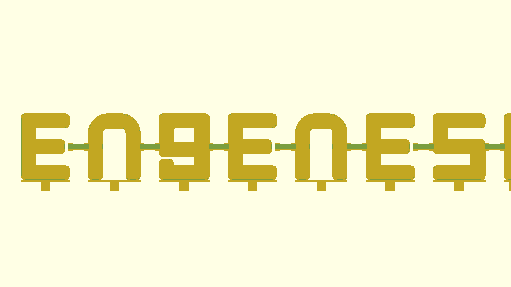
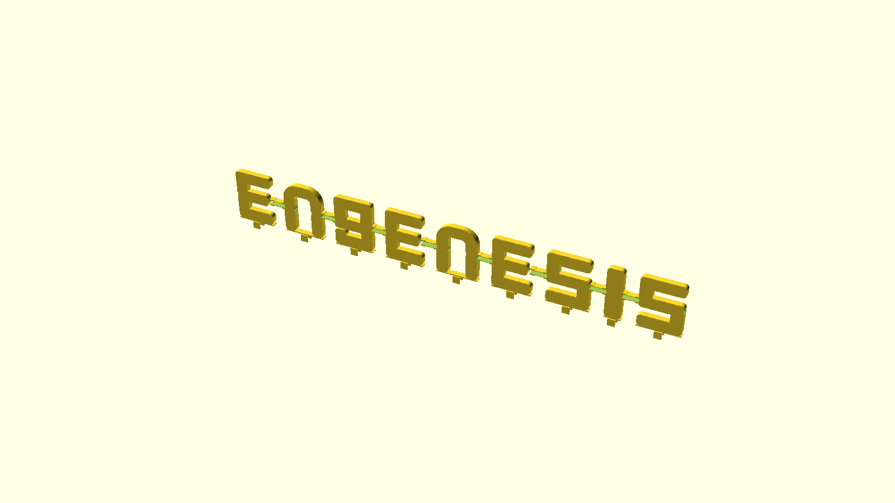

# Engenesis modular illuminated divider sign

This package is a parametric, modular design for the illuminated **ENGENESIS** divider sign. Its separate dark shell and translucent light face follow the proven Octolamp construction approach, while its letter geometry follows the supplied Engenesis wordmark.





## Included design

- Individual opaque letter shells
- Separately printed translucent letter diffusers
- Logo-profile E, n, g, and S light boxes rather than a substituted system font
- T-keyed, hollow bridges that mechanically interlock with each letter hub
- Separate bridge diffusers
- Divider clamps that avoid permanent furniture modification
- A reserved I module location for the future snake showpiece
- Full assembly preview

## Important measurements to verify

Before printing the full system, measure and update these variables near the top of `engenesis_lamp.scad`:

- `divider_t`
- `clip_leg_len`
- LED strip width and thickness
- Desired overall letter height
- Available sign length across the desk dividers

The default clip fits a 22 mm divider. Print only one short clip/bridge test first.

## Suggested materials

- Shells, bridges, and clips: black or dark navy PLA/PETG
- Diffusers: natural/translucent white PLA or PETG
- Optional flame modules: blue shell plus white diffuser, using the same construction as a letter

Single-color printing is supported because shells and diffusers are separate parts.

## Exporting parts

Open `engenesis_lamp.scad`, set `PART`, and export one STL at a time.

Examples:

```scad
PART = "letter";
GLYPH = "E";
```

```scad
PART = "bridge";
```

```scad
PART = "bridge_diffuser";
```

Press **F6**, then export as STL.

## Recommended prototype sequence

1. Print one bridge shell and one letter shell at reduced height or with a short test section.
2. Confirm the T-key/socket clearance. Adjust `port_clear` in 0.1 mm steps if needed.
3. Print one clip and bridge. Confirm divider fit using removable foam/felt pads.
4. Test the planned LED strip inside the bridge and letter cavity.
5. Only then print the complete wordmark.

## Electrical and facilities notes

- Keep the LED strip continuous through the bridges where bend radius allows.
- Where strip bending is too tight, use short soldered wire jumpers between modules.
- Size the power supply for the actual LED count and configured brightness.
- Use low-voltage, enclosed, strain-relieved wiring.
- Obtain Facilities approval before attaching or powering the installation in the office.

## Known limitations of this first pass

- The I is currently a placeholder; add a vector-traced snake module before final production.
- Divider dimensions and available sign width were not measured, so those parameters are provisional.
- Final LED routing, controller enclosure and power inlet should be adapted after selecting the exact strip/controller hardware.
