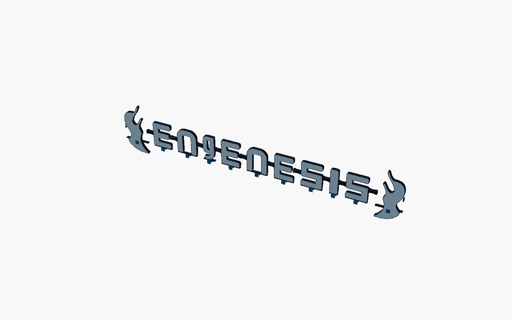

# Engenesis modular illuminated divider sign

This package is a parametric, modular design for the illuminated **ENGENESIS** divider sign. Its separate dark shell and translucent light face follow the proven Octolamp construction approach, while its letter geometry follows the supplied Engenesis wordmark.




## Included design

- Individual opaque letter shells
- Separately printed translucent letter diffusers
- Logo-profile E, n, g, Snake-I, and S light boxes rather than a substituted system font
- Octolamp-style rear cable grooves indented into the back face for clean inter-letter jumper routing (no external front bridges)
- Divider clamps that avoid permanent furniture modification
- Full assembly preview

## Important measurements to verify

Before printing the full system, measure and update these variables near the top of `engenesis_lamp.scad`:

- `divider_t`
- `clip_leg_len`
- LED strip width and thickness
- Desired overall letter height
- Available sign length across the desk dividers

The default clip fits a 22 mm divider. Print only one short clip/bridge test first.

## Suggested materials

- Shells, bridges, and clips: black or dark navy PLA/PETG
- Diffusers: natural/translucent white PLA or PETG
- Optional flame modules: blue shell plus white diffuser, using the same construction as a letter

Single-color printing is supported because shells and diffusers are separate parts.

## Octolamp Reference Wall Measurements

Exact dimensions measured directly from `octolamp/models/octolamp_black_outer_mini_sparkle_motion.stl` (applied directly to the Snake `I` base in `engenesis_lamp.scad`):

| Feature | Exact Measurement | Coordinates in Octolamp STL | Applied to Snake `I` (`i_base.scad`, along Y) |
|---|---:|---|---|
| **Total exterior depth** | **25.000 mm** | `Z = -12.000 .. +13.000 mm` | `Y = -12.500 .. +12.500 mm` (`i_box_d = 25`) |
| **Back floor thickness** | **1.000 mm** | `Z = -12.000 .. -11.000 mm` | `Y = +11.500 .. +12.500 mm` (`i_back_wall = 1`) |
| **Bottom ridge height** (above floor) | **11.000 mm** | `Z = -11.000 ..   0.000 mm` | `Y =  +0.500 .. +11.500 mm` (`i_bot_wall_h = 11`) |
| **Bottom ridge total thickness** | **6.000 mm** | `3.000 mm` outer wall + `3.000 mm` inward reflector ledge | `6.000 mm` printed (`3.0 mm` outer + `3.0 mm` inward ledge) |
| **Top wall height** (above reflector seat) | **13.000 mm** | `Z =   0.000 .. +13.000 mm` | `Y = -12.500 ..  +0.500 mm` (`i_top_wall_h = 13`) |
| **Top wall thickness** | **3.000 mm** | Uniform on outer rim, inner ring, and Octocat body | `3.000 mm` printed (`3.0 / model_scale` in X/Z) |
| **Cat-head snap V-groove** | **14.41 mm × 2.88 mm × 1.37 mm** | Starts `2.22 mm` behind front lip, 45° ramps, `1.37 mm` deep | Top crown & bottom foot of `I_base` (`Y = -10.28 .. -7.40 mm`) |
| **Chip holder outer frame** | **25.60 mm × 37.00 mm × 9.75 mm** | `R_outer = 4.0 mm`, `R_inner = 2.4 mm`, `1.6 mm` wall, `0.5 mm` top chamfer | 1:1 unscaled physical pocket (`22.4 × 33.8 mm`) at `X = -9.8 mm, Z = 80.5 mm` |
| **Chip holder PCB posts (×4)** | **Ø5.0 × 1.35 mm + Ø2.2 × 5.95 mm** | At `X = ±7.30 mm`, `Y_rel = -1.0 ± 12.70 mm` | Stepped PCB standoffs + locating pins, plus inner lid-snap ribs & side window |
| **Cable exit & strain relief** | **2× Ø5.0 mm + Ø14.2/4.0 mm keyhole** | Two zip-tie holes (`10 mm` pitch), keyhole + `5.0 × 6.0 mm` rear rim channel | Replicated 1:1 underneath the chip slot (`Z = 30.5 mm`, `19.5 mm`, bottom exit) |
| **Rear horizontal cable groove** | **4.00 mm × 6.00 mm (45° beveled roof)** | `4.01 mm` straight walls + `1.99 mm` 45° bevel across the `6.0 mm` bottom rim | Indented across the back of the bottom foot (`Z = 5.00 .. 9.00 mm`, `Y = +6.5 .. +12.5 mm`) |
| **Reflector plate (`white_reflector`)** | **2.00 mm thick, `16×9 mm` pocket + `1.5 mm` slit** | `R = 2.00 mm` rounded pocket over zip-tie holes + `1.50 mm` side-entry wire slit | `Y = -1.50 .. +0.50 mm` (`16.00 × 9.00 mm` pocket at `Z = 30.5 mm` + `1.50 mm` slit out `+X`) |
| **Hollow diffuser (`white_inner`)** | **15.00 mm total depth, `1.00 mm` wall** | `12.00 mm` deep skirt (`-0.50 mm` clearance) + `3.00 mm` 45° beveled front dome (`4.00 mm` proud of base lip) | `Y = -16.52 .. -1.52 mm` (`1.00 mm` hollow skirt + `45°` beveled dome resting against reflector) |
| **Diffuser snap tabs (`white_inner`)** | **13.20 mm wide × 3.00 mm × 1.50 mm** | `45°` V-ridges on skirt (`0.60 mm` side clearance, `+1.00 mm` engagement into `1.37 mm` groove) | Top crown & bottom foot snap tabs centered at `Y = -8.84 mm` (`0.39 mm` bottoming clearance) |

## Exporting parts

Standalone Snake `I` parts can be opened and exported directly from `letters/I/`:
- `letters/I/i_base.scad` — opaque shell, controller bay, reflector seat ledge/pillars, snap grooves, and divider clip
- `letters/I/i_reflector.scad` — internal white reflector plate
- `letters/I/i_diffuser.scad` — front translucent diffuser face

Standalone Logo-profile `E`, `g`, `n`, `S`, and end-cap flame (`FL` left flame, `FR` right flame) parts follow the same three-part layout in `letters/E/`, `letters/g/`, `letters/n/`, `letters/S/`, `letters/FL/`, and `letters/FR/` (`e_base.scad` / `g_base.scad` / `n_base.scad` / `s_base.scad` / `fl_base.scad` / `fr_base.scad`, `*_reflector.scad`, `*_diffuser.scad`). Each folder's `shape_pts.scad` holds the traced housing and diffuser silhouettes, and `lamp_core.scad` builds the parts from them.

Or open `engenesis_lamp.scad`, set `PART`, and export one STL at a time.

Examples:

```scad
PART = "letter";
GLYPH = "E";
```

```scad
PART = "letter_diffuser";
GLYPH = "E";
```

```scad
PART = "letter_reflector";
GLYPH = "E";
```

Press **F6**, then export as STL.

## Recommended prototype sequence

1. Print one bridge shell and one letter shell at reduced height or with a short test section.
2. Confirm the T-key/socket clearance. Adjust `port_clear` in 0.1 mm steps if needed.
3. Print one clip and bridge. Confirm divider fit using removable foam/felt pads.
4. Test the planned LED strip inside the bridge and letter cavity.
5. Only then print the complete wordmark.

## Electrical and facilities notes

- Keep the LED strip continuous through the bridges where bend radius allows.
- Where strip bending is too tight, use short soldered wire jumpers between modules.
- Size the power supply for the actual LED count and configured brightness.
- Use low-voltage, enclosed, strain-relieved wiring.
- Obtain Facilities approval before attaching or powering the installation in the office.

## Known limitations of this first pass

- The I is currently a placeholder; add a vector-traced snake module before final production.
- Divider dimensions and available sign width were not measured, so those parameters are provisional.
- Final LED routing, controller enclosure and power inlet should be adapted after selecting the exact strip/controller hardware.
