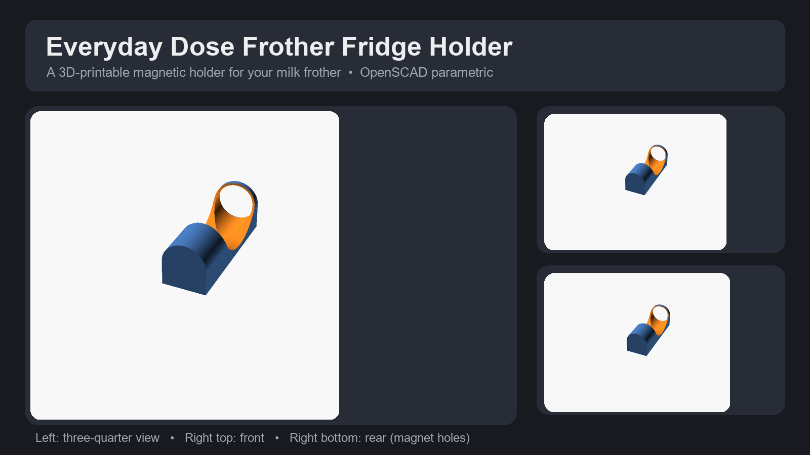

# Everyday Dose Frother Fridge Holder

A 3D-printable, magnetic, wall/fridge mount that holds the Everyday Dose
**Milk Frother** by its handle. Keeps the frother off the counter and within
reach next to your coffee setup.



## Why this design

The frother handle is roughly **33 mm in diameter** and **110 mm deep**, which
is bigger than the original pen-holder the design is based on. This derivative
widens the bore to fit the frother (with ~2.5&nbsp;mm of clearance) and, in v2,
adds a **third magnet hole in the middle of the back** for extra grip so the
holder does not sag once the frother slides in.

## What you need

- A 3D printer (anything with a ~120&nbsp;mm×120&nbsp;mm or larger bed works —
  the part is small).
- Filament — PLA, PETG or ABS all work fine. A single color is enough.
- **3× neodymium disc magnets** — designed for **12 mm diameter × 3 mm thick**
  magnet holes.

## Printing

Recommended slicer settings:

- **Resolution:** 0.1 – 0.2 mm layer height
- **Infill:** ~20% (gyroid works well)
- **Supports:** none required
- **Raft:** not required
- **Orientation:** print flat with the back of the holder on the build plate
  (the same orientation the model is authored in). The cylindrical bore then
  prints vertically with no overhangs.

## Print files

| File | Description |
|---|---|
| `everyday-dose-frother-fridge-holder-v2.stl` | Ready-to-print mesh (3 magnets) |
| `everyday-dose-frother-fridge-holder-v2.scad` | Parametric OpenSCAD source |

## Customizing the dimensions

Open `everyday-dose-frother-fridge-holder-v2.scad` in
[OpenSCAD](https://openscad.org/) and adjust the parameters at the top of the
file, then hit **F6** (preview/render) and **F7** (export STL).

| Parameter | Default | What it controls |
|---|---|---|
| `Material_Thickness` | 2 mm | Minimum wall/material thickness |
| `Frother_Hole_Diameter` | 35.5 mm | Handle diameter + clearance |
| `Frother_Hole_Depth` | 110 mm | How deep the frother sits |
| `Magnet_Hole_Diameter` | 12 mm | Magnet hole size (see note) |
| `Magnet_Hole_Depth` | 3 mm | Magnet thickness |

> **Note on magnet fit:** neodymium magnets often print snug. If the magnet
> hole is a touch small, the design allows you to lower
> `Magnet_Hole_Diameter` so the magnet presses in, then widen it with a flat
> screwdriver, or raise it slightly and use a dab of glue.

## Assembly

1. Print the holder.
2. Press a 12 mm × 3 mm neodymium magnet into each of the three holes on the
   back. The holes are sized for a press fit; if they are loose, secure them
   with a small amount of superglue or epoxy.
3. Slide the fork of the holder over the handle of your Everyday Dose frother.
4. Attach the holder to the fridge (or any ferromagnetic surface).

```
   [front]         frother handle slides
   (bore)   <--------------- in here from above
```

## Regenerating the preview images

The preview images were rendered from the source with OpenSCAD:

```bash
openscad -o images/render-front.png      --camera forward,400,0,0,0,3210,1098 --imgsize 1200,900 --viewall --colorscheme Tomorrow everyday-dose-frother-fridge-holder-v2.scad
openscad -o images/render-threequarter.png --camera gimbal,480,55,30,0,3210,1098 --imgsize 1024,1024 --viewall --colorscheme Tomorrow everyday-dose-frother-fridge-holder-v2.scad
openscad -o images/render-rear-angle.png --camera gimbal,460,-135,20,0,3210,1098 --imgsize 1200,900 --viewall --colorscheme Tomorrow everyday-dose-frother-fridge-holder-v2.scad
```

`hero.png` is a composited montage of those renders.

## Attribution & License

This model is derived from the **Fully Customizable Pen Holder Fridge Magnet**
by **Code and Make** ([codeandmake.com](https://codeandmake.com/post/pen-holder-fridge-magnet)).

Per the original author's licensing:

- The `.scad` code is licensed under the **MIT License** (© Code and Make).
- The `.stl` model is licensed under **CC BY 4.0**.

This derivative therefore inherits **CC BY 4.0** for the geometry and **MIT**
for the code. See the repository `LICENSE` for details.